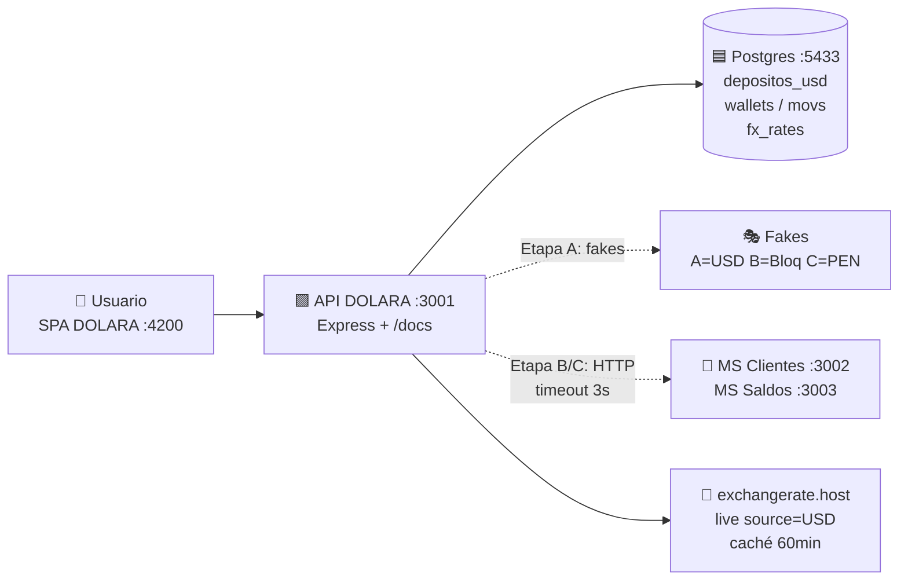
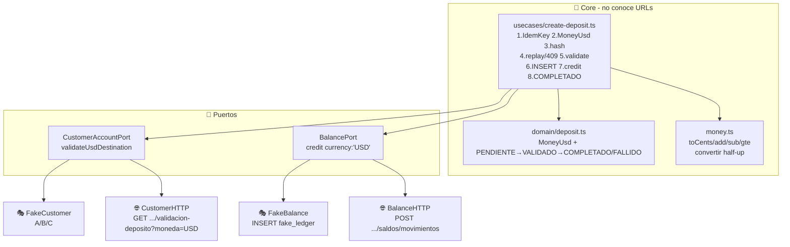
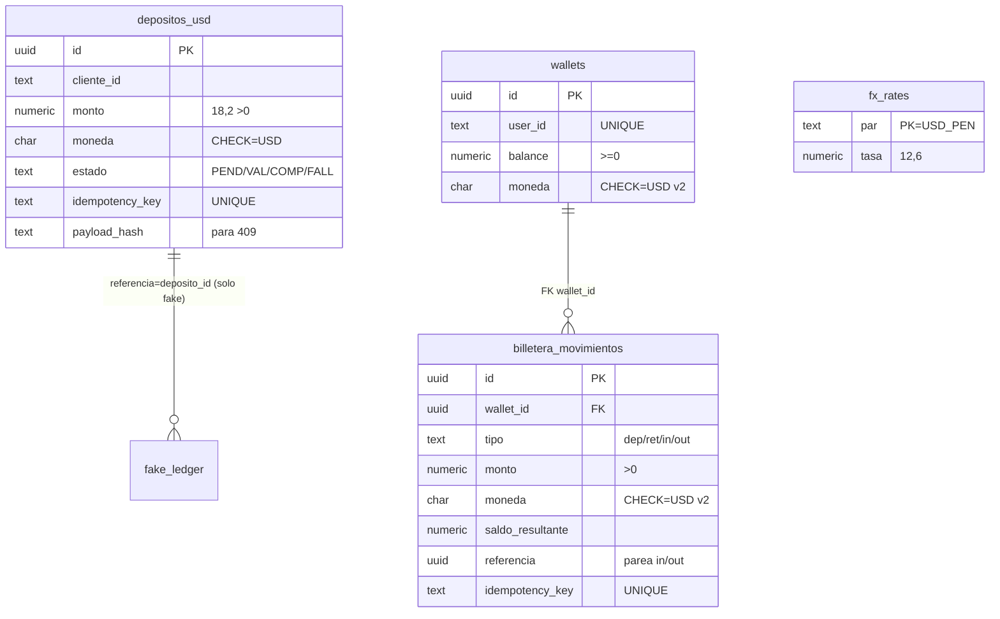
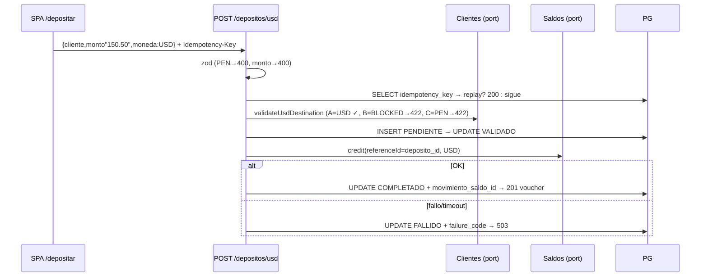
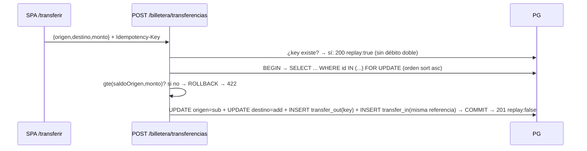

# 06 — Arquitectura y flujos · DOLARA Billetera USD-only (v2)

> Lectura en 5 min: qué es, dónde vive cada cosa, cómo fluye el dinero y dónde mirar el código.
> Detalle canónico en `01`, contratos en `02`, pasos en `03`, pruebas en `04`, despliegue en `05`. Este doc es el **mapa visual**.

---

## 1. El sistema en 30 segundos

```
┌─────────────────────────────────────────────────────────┐
│  DOLARA — Tu billetera en dólares · 100% USD            │
│  SPA móvil (Angular) + API (Express) + Postgres          │
│  Dinero: string "150.50" · NUMERIC(18,2) · cero floats   │
│  Regla de oro: nada persiste ni acredita en PEN          │
└─────────────────────────────────────────────────────────┘
```

| Pregunta | Respuesta rápida |
|----------|------------------|
| ¿Dónde está la arquitectura original? | `01_SDD_… §3 principios, §7 hexagonal, §8 dominio, §10 persistencia, §9 flujo, §13 idempotencia` |
| ¿Dónde están los contratos? | `02_CONTRATOS_…` + `plan.md §4` + Swagger `GET /docs` |
| ¿Dónde está el CÓMO implementado? | `plan.md` + este doc + `backend/src` |
| ¿Qué es core de clase vs propio? | Core: `depositos_usd` (saldo externo). Propio DOLARA: `wallets` + FX referencial. Separados (C11) |
| ¿Cómo lo corro? | `docker compose up -d --build` → web `:4200` · api `:3001` · db host `:5433` |

---

## 2. Mapa de contenedores (C4 nivel 2)



```text
                    ┌──────────────┐
                    │   DOLARA SPA │  :4200  (nginx → /api → ms-depositos-usd:3001)
                    │ 6 pantallas  │
                    └──────┬───────┘
                           │ REST /api/v1 + Idempotency-Key + X-Correlation-Id
                    ┌──────▼───────┐
                    │ API Express  │  :3001
                    │ routes/      │  deposits · billetera · fx · health · /docs
                    │ usecases/    │  crearDeposito (15 pasos)
                    │ domain/      │  MoneyUsd + máquina estados
                    │ adapters/    │  fakes (A) / http (B/C)
                    └──────┬───────┘
              ┌────────────┼────────────┐
              ▼            ▼            ▼
        ┌──────────┐ ┌──────────┐ ┌──────────┐
        │ Postgres │ │ Clientes │ │  Saldos  │   Etapa A = fakes
        │  :5433   │ │  :3002   │ │  :3003   │   (ledger fake_ledger)
        └──────────┘ └──────────┘ └──────────┘
```

Red Docker: `wallet-network`. Entre contenedores **nunca `localhost`** (`05 §3`).

---

## 3. Hexagonal: puertos y adaptadores (C9)



> Cambiar de fakes a real = `USE_FAKES=false` + URLs. El caso de uso **no cambia** (C9).

**Billetera USD** (`routes/billetera.ts`) es SQL directo transaccional, sin puertos — no integra con Saldos/Clientes (C11).

---

## 4. Base de datos: 5 tablas, 2 dominios separados



```
depositos_usd  = recargas auditadas (externo)  · moneda USD CHECK
wallets        = saldo propio DOLARA           · moneda USD CHECK (v2)
billetera_mov  = movimientos inmutables        · solo INSERT, jamás UPDATE/DELETE
fx_rates       = caché tasa                    · 1 fila USD_PEN
fake_ledger    = idempotencia fake             · se desecha en Etapa B/C
```

---

## 5. Flujos (el dinero paso a paso)

### F1 · Recargar USD auditado → `201 COMPLETADO` (HU-1, RF-1..RF-5)



Estados: `PENDIENTE → VALIDADO → COMPLETADO | FALLIDO`. Replay misma key+mismo hash → original sin 2º abono. Distinto payload → `409 IDEMPOTENCY_CONFLICT`.
> No mueve `wallets.balance`: es dinero del dueño externo con voucher. El abono a tu saldo es una acción separada del usuario (botón "Abonar a mi billetera" en Recargar → `POST /billetera/wallets/:id/depositos`). Dominios separados (C11).

### F2 · Operar billetera (HU-6, RF-10) — aritmética exacta v2

```text
POST /billetera/wallets/:id/depositos|retiros {monto:"50.00"}
  → BEGIN → SELECT ... FOR UPDATE → gte(saldo,monto)? (retiro)
  → nuevo = add/sub(saldo,monto)   ← centavos enteros, cero floats
  → UPDATE balance + INSERT movimiento(moneda USD) → COMMIT → 201
  → sin fondos → ROLLBACK → 422 FONDOS_INSUFICIENTES (nada cambia)
```

### F3 · Transferir USD (HU-7, RF-11) — anti-deadlock + idempotente



### F4 · FX referencial (HU-4, RF-8) — nunca acredita

```text
GET /fx/tasa?par=USD_PEN → {tasa, stale:false|true}  (caché 60min, fallback última, 503 sin tasa)
POST /fx/convertir {monto,de,a} → USD→PEN | PEN→USD half-up · USD→USD eco · PEN→PEN 400 (v2)
```
También tener como referencia data de otros sistemas
puesto que este módulo se integrará a otros más que son clientes, billetera en soles, etc.
---

## 6. Errores y códigos (C10)

```
400 VALIDATION_ERROR / INVALID_AMOUNT / MONTO_INVALIDO / SIN_IDEMPOTENCIA / MISMA_BILLETERA
404 NOT_FOUND / CUSTOMER_NOT_FOUND / ACCOUNT_NOT_FOUND / NO_ENCONTRADA
409 IDEMPOTENCY_CONFLICT / YA_EXISTE
422 CUSTOMER_BLOCKED / USD_ACCOUNT_NOT_ENABLED / FONDOS_INSUFICIENTES
503 CUSTOMER_SERVICE_UNAVAILABLE / BALANCE_SERVICE_UNAVAILABLE / FX_NO_DISPONIBLE
```

Formato siempre: `{status, code, message, correlation_id, timestamp}` + header `X-Correlation-Id`.

---

## 7. Frontend DOLARA: 6 pantallas banca móvil

```
            ┌────────── TOPBAR DOLARA ($ + USD ● $) ──────────┐
            │  hero saldo USD · chip USD-only · T.C. ref · 👁  │
            │  [💵 Recargar] [🏧 Retirar] [🔀 Transferir] [💱]  │
            └─────────────────────────────────────────────────┘
 /inicio (dashboard)   /billetera (operar)   /transferir
 /depositar (voucher)  /historial (billetera+depósitos)  /fx (referencial)
            └────────── TABBAR fija: 🏠 👛 💵 🧾 💱 ──────────┘
```

| Ruta | Qué hace | API |
|------|----------|-----|
| `/inicio` | Saldo + crear/cargar wallet (UUID o user_id con fallback `by-user`) + últimos 5 movs | `GET billetera/:id` → fallback `GET billetera/by-user/:userId`, `movimientos`, `tasa` |
| `/billetera` | Recargar / retirar con validación `0.00` | `POST :id/depositos`, `:id/retiros` |
| `/transferir` | Origen→destino atómica | `POST transferencias` + key auto |
| `/depositar` | Depósito auditado con voucher | `POST depositos/usd` + key auto |
| `/historial` | Billetera + depósitos | `GET movimientos`, `GET depositos/usd?cliente` |
| `/fx` | `USD→PEN / PEN→USD` display | `GET tasa`, `POST convertir` |

Archivos: `frontend/src/app/api.service.ts` (único servicio), `app.routes.ts`, `app.component.ts` (shell+tabbar), `pages/*.component.ts`, `styles.css` (design system).

---

## 8. Trazabilidad RF → código → tests (C7)

| RF | Código | Tests |
|----|--------|-------|
| RF-1..RF-5 | `usecases/create-deposit.ts`, `routes/deposits.ts`, `validators.ts` | `usecase.test UC-01..06`, `api.test E2E/replay/409` |
| RF-6 | `routes/deposits.ts GET` | `api.test get_by_id/historial` |
| RF-7 | `routes/health.ts`, `index.ts /docs` | `api.test health/docs/errores` |
| RF-8 | `fx.ts`, `money.convertir`, `routes/fx.ts` | `fx.test`, `api.test fx_*` |
| RF-9..RF-12 | `routes/billetera.ts` (v2 `add/sub/gte` + `moneda USD`), `db.ts` v2 | `billetera.test` |
| RF-13 (v3 acceso demo) | `routes/billetera.ts /registro /login /usuarios/buscar`, `db.ts` v3 (`nombre/pin_hash`), `fakes.ts` acepta wallets registradas, `auth.service.ts` + `auth.guard.ts` + `/acceso` | suite 37/37 + `ng build` + manual alias+PIN |
| v2 USD-only | `validators.monedaUsdSchema`, `fx PEN→PEN 400` | `tsc` + curl manual + `money/domain 10/10` |
| SPA DOLARA | `frontend/src/app/**` (v3: sesión, sidebar desktop ≥960px, tabbar solo móvil) | `ng build` + manual 7 rutas |

---

## 9. Dónde tocar según la tarea (índice rápido)

```
Quiero…                          → archivo
Nueva validación de monto/moneda  → backend/src/validators.ts + routes/deposits.ts
Cambiar regla de saldo/estados    → backend/src/domain/deposit.ts + usecases/create-deposit.ts
Cambiar cálculo exacto            → backend/src/money.ts (¡nunca Number() en dinero!)
Nueva tabla/columna               → backend/src/db.ts (nueva entrada MIGRATIONS, C4)
Integrar Clientes/Saldos reales   → backend/src/adapters/http.ts + .env URLs (C9)
Nueva pantalla                    → frontend/src/app/pages/*.component.ts + app.routes.ts + api.service.ts
Cambiar marca/colores             → frontend/src/styles.css + app.component.ts + index.html
Nuevo endpoint documentado        → backend/src/routes/*.ts (@openapi) → visible en /docs (C5)
```

Diagrama ASCII para terminal (sin mermaid):

```
[SPA :4200] --/api/v1--> [Express :3001] --SQL--> [PG :5433]
                              |--ports--> [fakes|A]  (USE_FAKES=true)
                              |--http---> [clientes:3002 saldos:3003] (B/C)
                              |--fetch--> [exchangerate.host] (FX 60min caché)
```

---

## 10. Acceso demo v3 (sin auth real) + responsive experto

```
Registro: POST /billetera/registro {user_id, nombre, pin} → 201 {id,user_id,nombre,balance USD} (pin SHA-256, 409 si existe)
Login:    POST /billetera/login {user_id, pin} → 200 sesión | 401 PIN_INCORRECTO | 404 alias no registrado
Sesión:   SPA la guarda en localStorage (AuthService, signal) → todas las pantallas usan la sesión:
          depositar con cliente_id=user_id (historial propio), operar/transferir/historial con wallet id,
          transferencia acepta alias (resuelve a UUID) + GET /usuarios/buscar?q= autocompletado.
Guard:    authGuard redirige a /acceso sin sesión. El auth real vivirá en el Gateway (S-8).
```

Responsive (una sola base de código):
```
Móvil <960px (como tu captura): hero + quick-grid 4 + cards apiladas + bottom tabbar fija.
Escritorio ≥960px: topbar full + grid sidebar 248px + contenido (max 1280px),
  dashboard en 2 columnas (movimientos + cuenta), tabbar oculta, hero $ grande.
```
