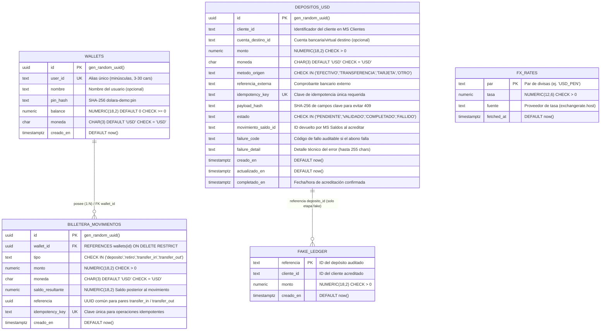
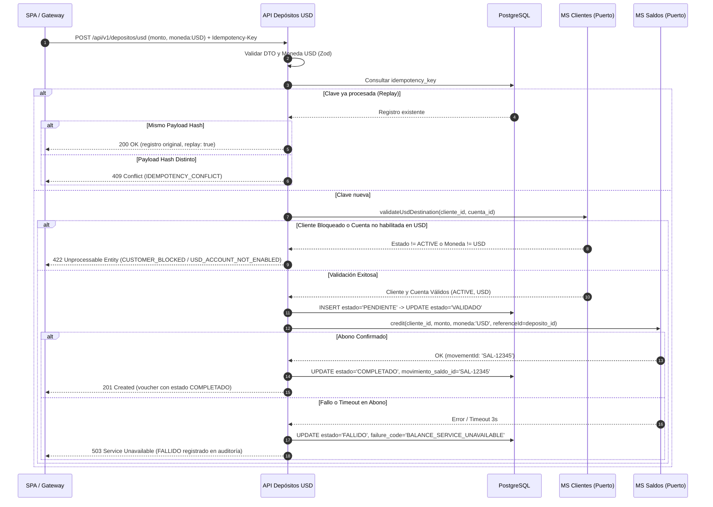
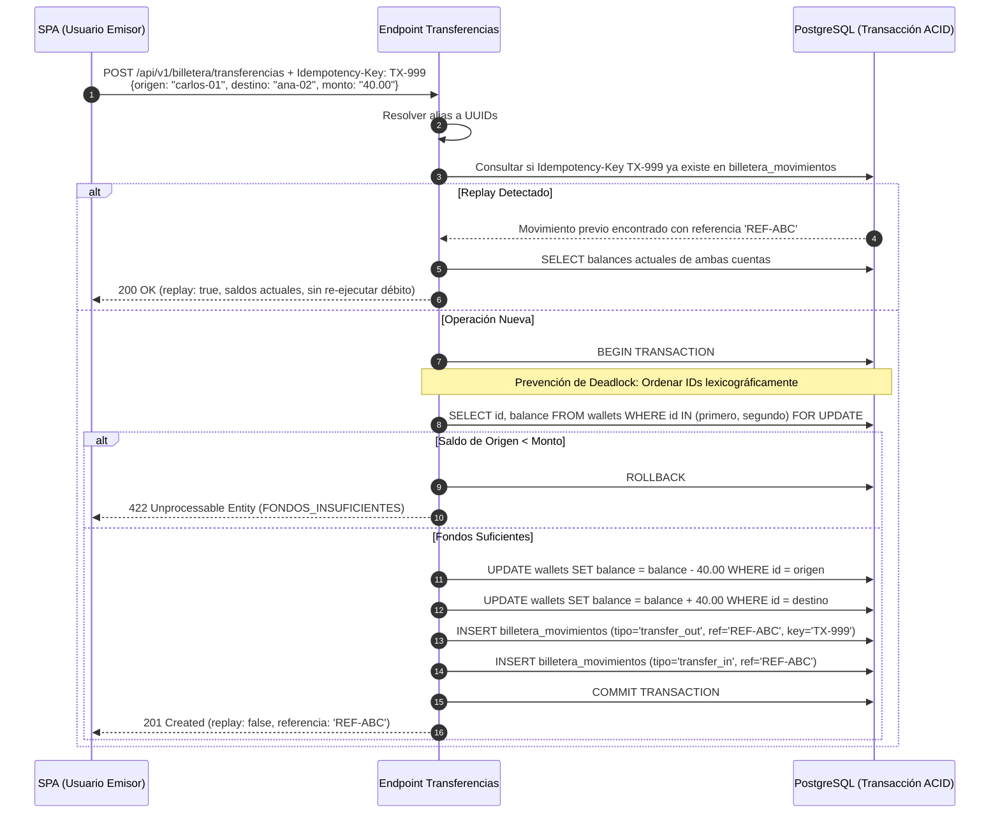
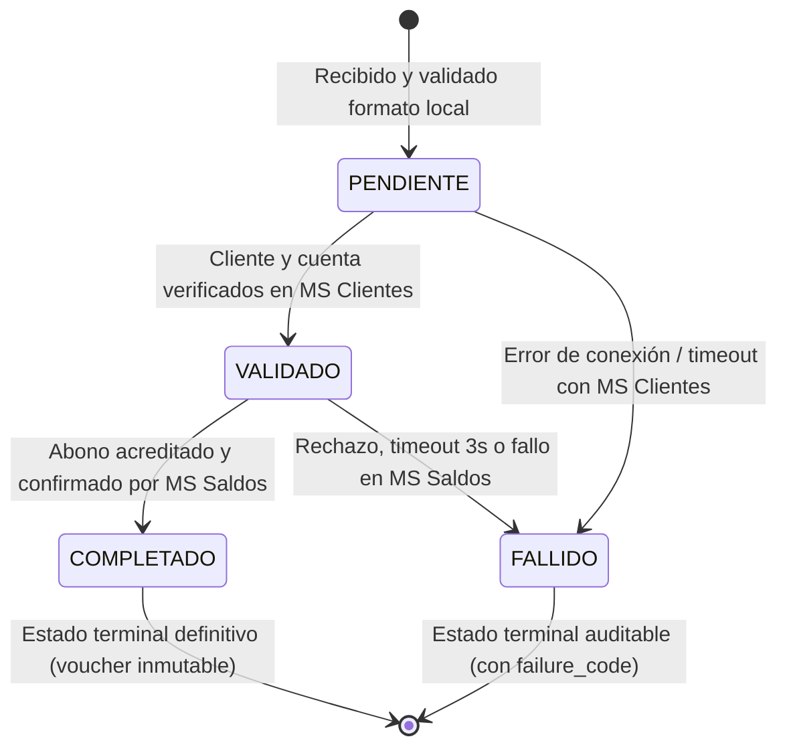

# 07 — Casos de Usuario, Modelo de Datos y Estándares de Ingeniería · DOLARA (v2)

> **Propósito del documento**: Servir como especificación formal de ingeniería para el desarrollo funcional, pruebas y auditoría de la billetera digital en dólares (**DOLARA**). Define los **Casos de Uso de Usuario** estructurados, el **Diagrama Entidad-Relación (ERD) completo de Base de Datos**, los **Diagramas de Estado y Secuencia** y los **Estándares Técnicos y Financieros** obligatorios del sistema.

---

## 1. Modelo de Datos y Diagrama de Base de Datos (ERD)

El sistema opera sobre PostgreSQL 16+. La arquitectura de persistencia se divide en dos dominios claramente desacoplados:
1. **Dominio de Auditoría de Depósitos Inter-servicios (`depositos_usd` y `fake_ledger`)**: Trazabilidad de recargas externas que interactúan con los microservicios de Clientes y Saldos.
2. **Dominio Transaccional de Billetera DOLARA (`wallets` y `billetera_movimientos`)**: Manejo del balance propio del usuario, transferencias entre cuentas y libro mayor de movimientos inmutables.
3. **Módulo Informativo FX (`fx_rates`)**: Almacenamiento en caché de tasas de cambio referenciales sin impacto en saldos.

### 1.1 Diagrama Entidad-Relación Completo (Mermaid ERD)



### 1.2 Diccionario de Datos e Índices

| Tabla | Columna | Tipo | Restricciones / Reglas | Propósito |
|-------|---------|------|------------------------|-----------|
| `wallets` | `id` | `UUID` | `PK`, `DEFAULT gen_random_uuid()` | Identificador universal inmutable de la billetera. |
| `wallets` | `user_id` | `TEXT` | `NOT NULL`, `UNIQUE` | Alias o username del cliente (`^[a-z0-9][a-z0-9_-]*$`). |
| `wallets` | `nombre` | `TEXT` | `NULLABLE`, máx 60 caracteres | Nombre público para despliegue y autocompletado. |
| `wallets` | `pin_hash` | `TEXT` | `NULLABLE` | Hash SHA-256 con prefijo del PIN demo (4 a 6 dígitos). |
| `wallets` | `balance` | `NUMERIC(18,2)` | `NOT NULL`, `DEFAULT 0`, `CHECK (balance >= 0)` | Saldo disponible en dólares. Jamás negativo. |
| `wallets` | `moneda` | `CHAR(3)` | `NOT NULL`, `DEFAULT 'USD'`, `CHECK (moneda = 'USD')` | Blindaje USD-only. Impide saldo en soles u otras divisas. |
| `wallets` | `creado_en` | `TIMESTAMPTZ` | `NOT NULL`, `DEFAULT now()` | Timestamp de creación. |
| `billetera_movimientos` | `id` | `UUID` | `PK`, `DEFAULT gen_random_uuid()` | Identificador del movimiento de libro mayor. |
| `billetera_movimientos` | `wallet_id` | `UUID` | `NOT NULL`, `FK -> wallets(id)` | Billetera afectada. |
| `billetera_movimientos` | `tipo` | `TEXT` | `NOT NULL`, `CHECK IN ('deposito','retiro','transfer_in','transfer_out')` | Tipo de movimiento contable. |
| `billetera_movimientos` | `monto` | `NUMERIC(18,2)` | `NOT NULL`, `CHECK (monto > 0)` | Monto transferido o abonado. |
| `billetera_movimientos` | `saldo_resultante`| `NUMERIC(18,2)` | `NOT NULL` | Balance exacto de la billetera tras el movimiento. |
| `billetera_movimientos` | `referencia` | `UUID` | `NULLABLE` | ID correlativo común que une asientos pareados. |
| `billetera_movimientos` | `idempotency_key` | `TEXT` | `NULLABLE`, `UNIQUE` | Previene duplicación de transferencias u operaciones. |
| `depositos_usd` | `id` | `UUID` | `PK`, `DEFAULT gen_random_uuid()` | Identificador de la recarga inter-servicio. |
| `depositos_usd` | `idempotency_key` | `TEXT` | `NOT NULL`, `UNIQUE` | Clave enviada en cabecera `Idempotency-Key`. |
| `depositos_usd` | `payload_hash` | `TEXT` | `NOT NULL` | Huella SHA-256 del cuerpo para validar conflictos (409). |
| `depositos_usd` | `estado` | `TEXT` | `NOT NULL`, `CHECK IN ('PENDIENTE','VALIDADO','COMPLETADO','FALLIDO')` | Estado del ciclo de vida del depósito. |
| `depositos_usd` | `movimiento_saldo_id` | `TEXT` | `NULLABLE` | Comprobante emitido por MS Saldos al abonar. |

#### Índices de Rendimiento Obligatorios
- `idx_depositos_usd_cliente_fecha`: `ON depositos_usd(cliente_id, creado_en DESC)` (Búsquedas rápidas de historial del usuario).
- `idx_depositos_usd_estado`: `ON depositos_usd(estado)` (Monitoreo de depósitos pendientes o fallidos).
- `idx_billetera_mov_wallet`: `ON billetera_movimientos(wallet_id, creado_en DESC)` (Paginación de movimientos de billetera).

---

## 2. Casos de Usuario y Casos de Uso Detallados (BDD Gherkin)

### CU-00: Registro y Acceso Demo Seguro (Alias + PIN)
- **Actor Principal**: Usuario de la Billetera (SPA DOLARA).
- **Precondiciones**: Ninguna.
- **Postcondiciones**: Se crea una billetera en dólares con saldo `0.00` y sesión local activa.

```gherkin
Escenario: Registro exitoso de nuevo usuario
  Dado que el alias "carlos-01" no existe en la base de datos
  Cuando el usuario envía POST /api/v1/billetera/registro con alias "carlos-01", nombre "Carlos" y PIN "1234"
  Entonces el sistema responde con código HTTP 201 Created
  Y el cuerpo incluye el id, user_id "carlos-01", balance "0.00" y moneda "USD"
  Y el PIN queda almacenado como hash SHA-256 con prefijo de sal

Escenario: Intento de registro con alias duplicado
  Dado que ya existe un usuario con alias "carlos-01"
  Cuando el usuario envía POST /api/v1/billetera/registro con alias "carlos-01"
  Entonces el sistema responde con código HTTP 409 Conflict
  Y el código de error retornado es "YA_EXISTE"

Escenario: Autenticación exitosa (Login)
  Dado que el usuario "carlos-01" está registrado con PIN "1234"
  Cuando envía POST /api/v1/billetera/login con alias "carlos-01" y PIN "1234"
  Entonces el sistema responde con código HTTP 200 OK
  Y la SPA almacena la sesión en localStorage y redirige a /inicio

Escenario: Autenticación fallida con PIN erróneo
  Dado que el usuario "carlos-01" está registrado con PIN "1234"
  Cuando envía POST /api/v1/billetera/login con alias "carlos-01" y PIN "9999"
  Entonces el sistema responde con código HTTP 401 Unauthorized
  Y el código de error retornado es "PIN_INCORRECTO"
```

---

### CU-01: Depósito en USD Auditado con Voucher (Microservicio Core)
- **Actor Principal**: Usuario o Gateway/Canal Externo.
- **Actores Secundarios**: Microservicio de Clientes, Microservicio de Saldos.
- **Precondiciones**: El cliente debe existir y estar activo en el MS Clientes, con cuenta habilitada para USD. Cabecera `Idempotency-Key` obligatoria.
- **Postcondiciones**: El depósito alcanza el estado `COMPLETADO`, se registra en el ledger y se emite voucher.



```gherkin
Escenario: Depósito USD exitoso
  Dado que el cliente "carlos-01" está activo y habilitado para USD en MS Clientes
  Cuando se envía POST /api/v1/depositos/usd con monto "150.50", moneda "USD" y cabecera "Idempotency-Key: DEP-001"
  Entonces el sistema responde con código HTTP 201 Created
  Y el estado del depósito es "COMPLETADO"
  Y el campo "movimiento_saldo_id" contiene el identificador de confirmación

Escenario: Rechazo de depósito en moneda no permitida (PEN)
  Cuando se envía POST /api/v1/depositos/usd con monto "100.00" y moneda "PEN"
  Entonces el sistema responde inmediatamente con código HTTP 400 Bad Request
  Y el código de error es "VALIDATION_ERROR"
  Y no se realiza ninguna llamada a Clientes, Saldos ni base de datos
```

---

### CU-02: Operaciones en Billetera USD — Recarga y Retiro Atómico
- **Actor Principal**: Usuario Autenticado.
- **Precondiciones**: La billetera debe existir. En retiros, el saldo disponible debe ser mayor o igual al monto solicitado.
- **Postcondiciones**: El saldo de la billetera se actualiza con precisión de centavos y se inserta un registro inmutable en `billetera_movimientos`.

```gherkin
Escenario: Recarga directa en billetera DOLARA
  Dado que la billetera tiene un saldo actual de "100.00" USD
  Cuando el usuario envía POST /api/v1/billetera/wallets/{id}/depositos con monto "50.25"
  Entonces la base de datos bloquea la fila de la billetera con FOR UPDATE
  Y el nuevo saldo resultante es "150.25" USD
  Y se inserta un movimiento tipo "deposito" con monto "50.25"
  Y la respuesta es HTTP 201 Created

Escenario: Retiro con fondos insuficientes
  Dado que la billetera tiene un saldo actual de "20.00" USD
  Cuando el usuario intenta retirar POST /api/v1/billetera/wallets/{id}/retiros con monto "50.00"
  Entonces el sistema ejecuta ROLLBACK en la transacción
  Y responde con código HTTP 422 Unprocessable Entity
  Y el código de error es "FONDOS_INSUFICIENTES"
  Y el saldo de la billetera permanece inalterado en "20.00" USD
```

---

### CU-03: Transferencia P2P entre Billeteras USD (Anti-Deadlock e Idempotente)
- **Actor Principal**: Usuario Emisor.
- **Precondiciones**: Ambas billeteras (origen y destino) deben existir y ser diferentes. El emisor debe contar con saldo suficiente. Cabecera `Idempotency-Key` requerida.
- **Postcondiciones**: Se debitan los fondos del emisor, se acreditan en el receptor de forma atómica y se generan dos movimientos vinculados por un UUID de referencia.



```gherkin
Escenario: Transferencia exitosa entre usuarios
  Dado que el usuario "carlos-01" tiene saldo "100.00" USD
  Y la usuaria "ana-02" tiene saldo "10.00" USD
  Cuando "carlos-01" envía POST /api/v1/billetera/transferencias con destino "ana-02", monto "25.00" y cabecera "Idempotency-Key: TX-1"
  Entonces el saldo de "carlos-01" queda en "75.00" USD
  Y el saldo de "ana-02" queda en "35.00" USD
  Y se crean dos registros de movimientos con el mismo UUID de referencia
  Y la respuesta es HTTP 201 Created

Escenario: Prevención de doble cargo por reintento de red (Idempotencia)
  Dado que la transferencia con "Idempotency-Key: TX-1" ya fue procesada exitosamente
  Cuando el cliente reenvía la misma petición con "Idempotency-Key: TX-1"
  Entonces el sistema no realiza un segundo débito
  Y responde HTTP 200 OK con los saldos vigentes y el indicador "replay: true"
```

---

### CU-04: Consulta de Tasa de Cambio Referencial USD/PEN (Resiliencia)
- **Actor Principal**: Cualquier usuario de la plataforma.
- **Precondiciones**: Ninguna.
- **Postcondiciones**: Se entrega la tasa vigente o una tasa en caché si el proveedor externo no responde.

```gherkin
Escenario: Obtención de tasa en vivo o caché válida
  Cuando el usuario consulta GET /api/v1/fx/tasa?par=USD_PEN
  Entonces el sistema responde HTTP 200 OK con la tasa actual y "stale: false"

Escenario: Conversión informativa USD a PEN
  Cuando el usuario envía POST /api/v1/fx/convertir con monto "10.00", de "USD" a "PEN"
  Entonces el sistema calcula el resultado utilizando redondeo comercial half-up
  Y devuelve el monto convertido sin alterar saldo alguno

Escenario: Rechazo de conversión entre monedas no soportadas (PEN a PEN)
  Cuando el usuario envía POST /api/v1/fx/convertir de "PEN" a "PEN"
  Entonces el sistema responde HTTP 400 Bad Request
```

---

## 3. Máquinas de Estado y Diagrama de Ciclo de Vida

### 3.1 Ciclo de Vida de un Depósito (`depositos_usd`)



**Reglas de Transición Inviolables**:
1. `COMPLETADO` y `FALLIDO` son **estados terminales**. Ningún registro en estos estados puede ser modificado.
2. Jamás se marca un depósito como `COMPLETADO` de forma especulativa; se requiere el identificador de confirmación del balanceador.
3. Todo fallo tras haber alcanzado `VALIDADO` persiste el motivo técnico en `failure_code` y `failure_detail` para permitir conciliación contable posterior.

---

## 4. Estándares Técnicos y de Ingeniería de Software

### Estándar 1: Aritmética Financiera y Precisión Decimal (Zero Floats)
* **Problema**: El tipo de datos `Number` de JavaScript se basa en IEEE-754 de punto flotante de 64 bits, produciendo imprecisiones inaceptables en dinero (ej. `0.1 + 0.2 = 0.30000000000000004`).
* **Regla Obligatoria**:
  1. En base de datos, toda columna monetaria debe ser estrictamente `NUMERIC(18,2)`.
  2. En contratos JSON (REST), los montos se transmiten **exclusivamente como cadenas de texto** con formato decimal exacto: `"150.50"`.
  3. En la lógica de aplicación (`backend/src/money.ts`), todo cálculo aritmético se realiza transformando la cadena a **centavos enteros (`BigInt` / enteros seguros)** antes de sumar, restar o comparar (`toCents()`, `add()`, `sub()`, `gte()`).
  4. Queda terminantemente prohibido el uso de `parseFloat()`, `Math.round()` con floats directos o conversión de saldos a `Number()` en rutas transaccionales.

### Estándar 2: Idempotencia Financiera Estricta (IETF RFC Draft)
* **Regla Obligatoria**:
  1. Toda mutación crítica (`POST /depositos/usd`, `POST /billetera/transferencias`) exige la cabecera HTTP `Idempotency-Key`.
  2. Al recibir la clave, el sistema genera una huella criptográfica SHA-256 (`payload_hash`) de los argumentos de entrada.
  3. **Comportamiento ante Replay**:
     - Misma clave + mismo hash $\rightarrow$ Devuelve respuesta original exitosa con código HTTP `200 OK` y atributo `replay: true` (sin re-ejecutar débitos ni abonos).
     - Misma clave + contenido modificado $\rightarrow$ Devuelve `409 Conflict` (`IDEMPOTENCY_CONFLICT`). Previene ataques de reutilización indebida de llaves.

### Estándar 3: Integridad Transaccional y Prevención de Deadlocks
* **Regla Obligatoria**:
  1. Toda operación que altere más de un balance se ejecuta dentro de un bloque transaccional ACID (`BEGIN ... COMMIT ... ROLLBACK`).
  2. **Bloqueo Pesimista Ordenado**: Al transferir entre billetera $A$ y billetera $B$, los bloqueos `SELECT ... FOR UPDATE` deben solicitarse siempre en **orden lexicográfico ascendente** de los identificadores (`[idA, idB].sort()`). Esto previene el clásico interbloqueo (*deadlock*) cuando ocurren transferencias concurrentes cruzadas ($A \rightarrow B$ y $B \rightarrow A$).

### Estándar 4: Seguridad y Protección de Datos Sensibles (OWASP & PCI-DSS)
* **Regla Obligatoria**:
  1. El PIN de acceso de los usuarios jamás se almacena en texto plano. Se almacena únicamente su digestión criptográfica `SHA-256` con prefijo salt (`dolara-demo:<pin>`).
  2. Todas las consultas a PostgreSQL utilizan consultas parametrizadas (`$1, $2, ...`) mediante la biblioteca `pg`. Cero concatenación manual de cadenas para neutralizar inyecciones SQL.
  3. Ningún secreto, credencial de base de datos o API key debe guardarse en el repositorio de Git. Todo se inyecta mediante variables de entorno (`.env` local, Docker Compose).

### Estándar 5: Trazabilidad y Observabilidad Distribuida
* **Regla Obligatoria**:
  1. Cada petición entrante debe poseer o generar un identificador de correlación (`X-Correlation-Id`).
  2. Todo registro de log de la aplicación debe incluir el `correlation_id` y el `deposito_id` (o `wallet_id`) asociado.
  3. Formato estándar unificado de errores para todas las respuestas no exitosas:
  ```json
  {
    "status": 422,
    "code": "FONDOS_INSUFICIENTES",
    "message": "fondos insuficientes",
    "correlation_id": "b3f0e4b8-2e0f-48d6-953f-a320c22d7a90",
    "timestamp": "2026-10-13T20:30:00.000Z"
  }
  ```

### Estándar 6: Cobertura y Calidad de Pruebas (Mínimo 80%)
* **Regla Obligatoria**:
  1. El microservicio debe mantener una cobertura de pruebas automatizadas mínima del **80%** en componentes críticos.
  2. Niveles de prueba requeridos:
     - **Pruebas Unitarias**: Entidad `Deposit`, Value Object `MoneyUsd`, funciones de redondeo y aritmética exacta de `money.ts`.
     - **Pruebas de Casos de Uso**: Ejecución del caso de uso `crearDeposito` simulando respuestas válidas, errores de validación y caídas de puertos.
     - **Pruebas de Integración**: Pruebas E2E de rutas Express contra base de datos PostgreSQL real (validando índices, restricciones de unicidad y bloqueos concurrentes).
     - **Pruebas de Concurrencia**: Verificación de que 10 peticiones concurrentes con la misma `Idempotency-Key` solo acreditan una vez.

---

## 5. Matriz de Trazabilidad (Requisitos vs. Casos de Uso vs. Pruebas)

| Requisito | Caso de Uso | Componente / Archivo | Suite de Pruebas |
|-----------|-------------|----------------------|------------------|
| **RF-1 .. RF-5** (Depósitos USD con Idempotencia) | `CU-01` | `usecases/create-deposit.ts`, `routes/deposits.ts` | `usecase.test.ts`, `api.test.ts (UC-01..06)` |
| **RF-6** (Auditoría e Historial de Depósitos) | `CU-01`, `CU-02` | `routes/deposits.ts` (`GET /`, `GET /:id`) | `api.test.ts (get_by_id, historial)` |
| **RF-7** (Observabilidad y Documentación) | Todos | `routes/health.ts`, Swagger `/docs` | `api.test.ts (health, docs, correlation)` |
| **RF-8** (Tasa de Cambio Referencial) | `CU-04` | `backend/src/fx.ts`, `routes/fx.ts` | `fx.test.ts`, `api.test.ts (fx_tasa, fx_convertir)` |
| **RF-9 .. RF-12** (Operaciones de Billetera DOLARA) | `CU-02`, `CU-03` | `routes/billetera.ts`, `backend/src/money.ts` | `billetera.test.ts`, `money.test.ts` |
| **RF-13** (Acceso Demo, Búsqueda de Usuarios) | `CU-00`, `CU-03` | `routes/billetera.ts` (`/registro`, `/login`, `/usuarios/buscar`) | `billetera.test.ts`, pruebas E2E SPA |
